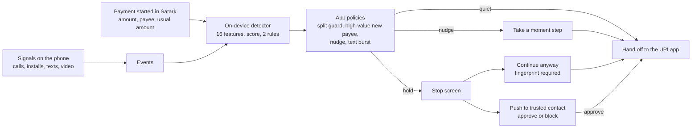

# Satark

**On-device scam protection for UPI payments. It stops the payment, not just the scam call.**

Satark is an Android app, an on-device detector and a small backend. It notices the pattern behind "digital arrest", remote-access and
fake-official scams (an unknown caller on the line, a risky app just installed, a large payment to someone new) and acts *before the money
moves*: it asks the person to pause, holds the payment, and can bring a trusted family member into the decision. The repository is
`Satark-Raksham`; the app and code are called Satark.

> **Status in one line:** a working prototype. Payments, the detector, the trusted-contact flow, sign-in and push notifications run on real
> phones against a test server. Every accuracy figure is from a simulator, and the production hardening is only partly done. The honest
> list is under [What works, and what does not](#what-works-and-what-does-not).

## Contents
1. [The problem](#the-problem)
2. [What Satark does](#what-satark-does)
3. [How a payment is decided](#how-a-payment-is-decided)
4. [Designed for being coerced](#designed-for-being-coerced)
5. [Privacy](#privacy)
6. [The detector](#the-detector)
7. [Evidence](#evidence)
8. [Architecture](#architecture)
9. [What works, and what does not](#what-works-and-what-does-not)
10. [Run it](#run-it)
11. [Repository layout](#repository-layout)
12. [Documentation](#documentation)
13. [Limitations](#limitations)
14. [Roadmap](#roadmap)

## The problem

UPI processed about **24 billion transactions worth ₹29.4 lakh crore in September 2026** ([report on NPCI data](https://startuptalky.com/upi-transactions-september-2026/)),
an average of roughly ₹1,200 a payment. Fraud is rare per transaction and severe per victim: cyber-fraud complaints in 2025 were about
**2.2 to 2.8 million, with about ₹19,800 to ₹22,500 crore lost** ([Moneylife](https://moneylife.in/article/housing-society-problems-and-solutions-occupancy-rights-leakage-disputes-and-agm-decisions/article/fraud-alert-india-is-losing-over-22000-crore-a-year-in-cyber-scams-and-the-worst-is-yet-to-come/80612.html)),
which is **about ₹80,000 to ₹90,000 per complaint**. Only around a tenth of stolen money is recovered. The Supreme Court has noted over ₹3,000 crore
lost to "digital arrest" scams, mostly by older people.

The money usually leaves the account in the victim's own hands, while a stranger is on the phone and the victim is frightened. Warnings in
an app are easy to tap away. Satark is built around that moment.

(These figures come from news reports of official data and the sources disagree with each other; check the primary source before quoting one as fact.)

## What Satark does

**Watches, on the phone only.** An unknown caller or video call (not in contacts), an app installed from outside Google Play or a remote-access
app, text bursts from strangers, how long a video session runs, and the person's usual payment size.

**Decides at the moment of payment.** Payments started in Satark (scan or type a UPI ID) are scored before anything is sent to the UPI app.

| Result | What the person sees |
|---|---|
| **Quiet** | Nothing. Ordinary payments are not interrupted. |
| **Nudge** | A "Take a moment" step before sending: the plain-language reasons, then *I'm sure, continue* or *Go back*. |
| **Hold** | A full-screen red **Stop. This looks like a scam.** The payment is not sent. |

**Brings a human in.** A held payment can be approved or blocked by a **trusted contact** who gets a push notification naming the person
("*Priya may be in danger. Please call them.*"). Linking is by phone number or pairing code, and the contact must accept. An unanswered hold
stays held.

**Resists the scammer.** "Continue anyway", turning protection off, changing the contact or age, and deleting data all need the person's fingerprint (or the phone's
screen-lock PIN on a phone with no fingerprint). Turning protection off waits 30 minutes and tells the trusted contact at once. A device-admin
guard blocks uninstalling and tells the contact if it is switched off.

**Stays small.** One optional sign-in (phone number and a one-time code), Hindi and English, and an age field that only makes the thresholds
stricter for people under 22.

When Satark warns and when it stays quiet is written out row by row in [docs/WHEN_SATARK_WARNS.md](docs/WHEN_SATARK_WARNS.md). Each row is checked by a test.

## How a payment is decided



The detector is frozen and can only be tightened by the app's own policies: they **add** warnings, they never remove one the detector raised.
The app policies are:
- **Split guard.** Several payments to the same new payee within an hour are added up.
- **High-value new payee.** ₹25,000 or more (₹10,000 or more for people under 22) to a payee not paid before, during or soon after an unknown call.
- **Nudge** when a payment is at least twice the person's usual.
- **Text burst** warnings for repeated texts from strangers. A message never changes a payment decision.

## Designed for being coerced

A scam victim is being steered by another person, sometimes with remote access to their screen. The design assumes that.

| Attack | Defence |
|---|---|
| "Tap Continue anyway" | Needs a fingerprint match (or the screen-lock PIN where there is no sensor). |
| "Turn Satark off" | A 30-minute wait, and the trusted contact is told immediately that it was requested. |
| "Uninstall it" | A device-admin guard blocks removal; switching the guard off alerts the contact. |
| "Change your trusted contact" | Fingerprint or PIN needed; the new contact has to accept. |
| Redirecting the contact's alerts | The contact's own phone registers its push address; the by-phone link never accepts one from the owner. |

## Privacy

- **Detection runs on the phone.** Raw call, install and text data never leaves it.
- **The server stores bands and hashes, not amounts or payees.** A payment is kept as a coarse amount band and a hashed payee.
- **The phone number is never stored.** Only a keyed hash (HMAC with a server secret) is kept, so a leaked database is not a list of numbers.
- **The signature store has no device identifier at all**, by schema, not by convention.
- **Pushes carry one short line.** No reasons, amounts or payees appear on the contact's lock screen.
- **Delete my data** erases a device's payments, alerts, links, tokens and account link.
- Sign-in is optional; without it Satark still protects the person, and the contact simply does not see a name.

## The detector

A small, explainable model that runs on the phone in a few lines of arithmetic and is deterministic (same events in, same decision out).

- **16 features** over the session: whether an unknown call or video is active or was recent, whether an app was installed during that call (from Google Play, outside it,
  or on a watch-list of remote-access apps), whether the payee is new or was added after the call, how large the amount is against the person's baseline,
  repeat payments to one payee, and two interaction terms (`contracts/schema.json`, `detector/src/main/resources/model.json`).
- **Logistic score** with a **split-conformal threshold per age band**, so the false-alarm target is a stated number per band, not a guess.
- **Two rules**: a sideload install during an unknown call, and an unknown video call that runs two hours.
- **Baseline**: the median of the last 50 completed payments, blended with a population prior of ₹161.57 while history is short.
- **Reason codes** (`contracts/reason_codes.json`) turn an alarm into one to three plain sentences, in English and Hindi (the Hindi is machine-drafted and needs a native speaker's review).

The Kotlin library is in [`detector/`](detector/); the Python reference and the simulator that generates the data are in `detector/reference/`.

## Evidence

**Every figure below is from SatarkSim, a simulator. None of it measures real-world accuracy.**

| Measure | Result | Target |
|---|---|---|
| Scam recall on validation | 538 of 578 = **93.1%** (95% interval 90.7 to 95.0) | at least 93% |
| False alarms on genuine sessions | 7 of 9,887 = **0.071%** (0.028 to 0.146) | at most 0.100% |
| Naive "call + payment" baseline | recall 53.1%, false alarms 3.9% | |
| After the ₹25,000 high-value rule | recall **96.5%**, false alarms **0.152%** | the rule costs 8 more genuine sessions held in 9,887, and is over the 0.100% target |

**What this does not show.** At a realistic fraud rate (about 1 in 1.47 lakh payments), even a 0.1% false-alarm rate gives a precision well under 1%.
The family-emergency scam is the known weak spot: it is built to look like the genuine family emergency, and it is caught 43 of 76 times in validation. The sealed
held-out run and the on-device speed target (100 ms) have not been run. Details and caveats: [`detector/detector_report.md`](detector/detector_report.md).

**Tests.** At the time of writing: server 286 tests pass (18 skipped); the Android app 190 unit tests pass; the detector runs its 36 vectors, a 732-session parity check and fuzz tests.
All of these run in CI on every pull request ([`.github/workflows/ci.yml`](.github/workflows/ci.yml)).

## Architecture

```
 Android app (Kotlin, Compose)                                  Backend (FastAPI)
┌─────────────────────────────────────┐                ┌────────────────────────────────────┐
│ signals: calls, installs, texts,    │                │ /auth     Key Attestation, JWT      │
│          video                      │                │ /account  phone hash + name         │
│ detector (16 features, conformal)   │   HTTPS        │ /risk-check  create payment, HOLD   │
│ app policies: split, high-value,    │  JWT bearer    │ /payments  state machine, decision  │
│          nudge, text burst          │ ─────────────► │ /trusted-contact  link, accept      │
│ Pay via Satark → UPI intent /       │                │ /alert   push to the contact (FCM)  │
│          Razorpay checkout          │                │ /webhooks/razorpay  paid / failed   │
│ fingerprint lock, protection-off    │                │ /signature  anonymous pattern store │
│          wait, device-admin guard   │                │ DB: payments, devices, links,       │
└──────────────────┬──────────────────┘                │     alerts, accounts, signatures    │
                   │ push (FCM)                        │ Redis: rate-limit counters only     │
                   ▼                                   └────────────────────────────────────┘
        Trusted contact's phone:  accept, approve or block a held payment
```

- **Payment state machines** (`server/app/payments/state_machine.py`): a checkout payment reaches `paid` only from a verified Razorpay webhook. A UPI-intent payment
  never reaches `paid`, because the UPI app's returned result is only reported, not verified.
- **Device identity** is Android Key Attestation (the key lives in secure hardware, and the app package and signing certificate are checked), not a password.
- **Mule check**: a payee paid by several devices in an hour escalates an otherwise-allowed payment to a hold.
- **Dual custody**: a held payment moves to approved or blocked only through a device the owner linked.

## What works, and what does not

**Verified on real phones** (two Android phones):
- Payments, the nudge step, the Stop screen, and the trusted-contact flow.
- Phone-number sign-in against a test server, using a fixed test code.
- A real Firebase push delivered to a second phone, naming the person.
- Hardware-backed device registration (Key Attestation) accepted by the server on a physical phone.
- The 30-minute protection-off wait and the device-admin removal guard. The lock's PIN fallback works; the fingerprint sensor on the second phone is not yet tested.

**Working, in test mode only:**
- A public Render test server, in development mode with fake dev tokens enabled. It is a demo server, not a hardened one.
- Razorpay checkout against the test account.

**Not done:**
- Production deployment: Google attestation roots pinned by a person, a release signing key, certificate pinning, and a restricted database role.
- Real SMS sign-in (the Firebase Phone provider is not enabled yet).
- Accuracy on real traffic, the sealed held-out run, and a pilot with real users.
- Holds on payments started *inside* another UPI app. Satark can only warn about those.
- Play Integrity (Key Attestation is used instead).

## Run it

**Server** (Python 3.11 or newer):

```bash
cd server
python -m venv .venv && source .venv/bin/activate     # Windows: .venv\Scripts\activate
pip install -e ".[dev]"
alembic upgrade head          # local SQLite file by default
uvicorn app.main:app --reload # http://localhost:8000/health
pytest                        # the server tests
```

All settings are environment variables prefixed `SATARK_`; the full list, with what is required in production, is in [docs/BACKEND.md](docs/BACKEND.md).

**Android app** (JDK 21 and the Android SDK; the Gradle wrapper is included):

```bash
# unit tests
./gradlew :app:testDebugUnitTest

# a debug build that talks to a server (use your own address)
./gradlew :app:assembleDebug -PsatarkBaseUrl=https://your-server/ -PsatarkDevOtp=true
adb install -r app/build/outputs/apk/debug/app-debug.apk
```

Useful build flags (debug builds only): `-PsatarkBaseUrl` (server address), `-PsatarkDevOtp=true` (the fixed sign-in code `123456`, only against a dev server),
`-PsatarkProtectionOffWaitMin=1` (shorten the 30-minute wait for a demo), `-PsatarkLongSessionTestMin=2` (shorten the two-hour video rule).
Push and real phone sign-in need a Firebase project: put its `google-services.json` in `app/` (it is git-ignored on purpose) and give the server the service-account JSON in `SATARK_FIREBASE_CREDENTIALS_JSON`.

**Detector:**

```bash
cd detector && gradle test                      # 36 vectors, parity and fuzz
python detector/tools/export_model.py           # retrain and export model.json
```

To try the main demo, call the phone from a number that is not in its contacts and, during the call, pay a new UPI ID ₹25,000 or more in Satark.
You should see the red Stop screen. More cases: [docs/DEMO_SPLIT_GUARD.md](docs/DEMO_SPLIT_GUARD.md) and [docs/RUN_THE_APP.md](docs/RUN_THE_APP.md).

## Repository layout

```
app/          Android app (Kotlin, Jetpack Compose): signals, events, payments, policies, UI, push, sign-in
detector/     On-device detector (Kotlin library), model, Python reference and simulator, reports
server/       FastAPI backend: auth, accounts, payments, alerts, webhooks, migrations, tests
contracts/    Shared contracts: API (OpenAPI), detector schema, reason codes, UPI mapping, auth
ops/          Evaluation pipeline, held-out runner, CI gates, security tools, strings, end-to-end checks
docs/         Walkthroughs, when Satark warns, roadmap, backend reference, round plans
data/         SatarkSim data and the 36 detector test vectors
render.yaml   Render blueprint for the backend
```

## Documentation

| Document | What it covers |
|---|---|
| [docs/WHEN_SATARK_WARNS.md](docs/WHEN_SATARK_WARNS.md) | Every situation, and what Satark does in it |
| [docs/APP_WALKTHROUGH.md](docs/APP_WALKTHROUGH.md) | The app, screen by screen |
| [docs/BACKEND.md](docs/BACKEND.md) | API, state machines, configuration, deployment, security notes |
| [docs/ROADMAP.md](docs/ROADMAP.md) | What was left out on purpose |
| [docs/ROUND1_PLAN_VS_DELIVERED.md](docs/ROUND1_PLAN_VS_DELIVERED.md) | Plan against delivery |
| [detector/detector_report.md](detector/detector_report.md) | Detector results and caveats |
| [contracts/api.yaml](contracts/api.yaml) | The API contract |
| [server/DEPLOY_CHECKLIST.md](server/DEPLOY_CHECKLIST.md) | Deploying the backend step by step |
| [notes.md](notes.md) | Current status and what is left |

## Limitations

- **Holds cover only payments started in Satark.** A payment made directly inside GPay, PhonePe or another UPI app can be warned about but not held. Wider coverage means embedding Satark in a payment or banking app.
- **UPI results are app-reported, not verified.** Only a Razorpay checkout is verified, by its webhook.
- **All accuracy figures are simulated.** Real-world accuracy is unknown.
- **Unknown-caller signals depend on phone permissions and the phone maker.** Without them the detector falls back to amount, payee and install signals.
- **Android only.** The signals and the hold flow rely on Android permissions that iOS does not offer.
- **Hindi warnings are machine-drafted** and need a native speaker's review.
- **The test server is not production.** See [What works, and what does not](#what-works-and-what-does-not).

## Roadmap

Near term (days): pin the Google attestation roots, move the server to production mode, enable real SMS sign-in, a short invite code to replace the long pairing code,
the sealed held-out run on two phones, and an on-device timing measurement.

Next (weeks): WhatsApp message flags (read-only, strangers only, no effect on payment decisions), a native-speaker review of the Hindi strings, certificate pinning, a load test, and a shadow-mode pilot with real users.

Later: embedding in a payment or banking app, a merchant risk API, and learning from real overrides. The full list, with why each item was left out, is in [docs/ROADMAP.md](docs/ROADMAP.md).
