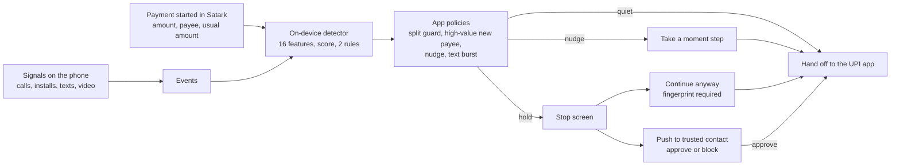

<div align="center">

# Satark

**On-device scam protection for UPI payments. It stops the payment, not just the scam call.**


</div>

Satark is an Android app, an on-device detector and a small backend. It recognises the pattern behind "digital arrest", remote-access and
fake-official scams (an unknown caller on the line, a risky app just installed, a large payment to someone new) and acts **before the money moves**:
it asks the person to pause, holds the payment, and brings a trusted family member into the decision. A scammer who is steering the victim's
screen cannot simply tap past it, switch it off or uninstall it.

> **Status:** a working prototype. Payments, the detector, the trusted-contact flow, sign-in and push notifications run on real phones against a test
> server. **Every accuracy figure comes from a simulator**, and production hardening is only partly done. The honest list is in
> [Status and limitations](#status-and-limitations).

## Contents

- [Why Satark](#why-satark)
- [Features](#features)
- [How it works](#how-it-works)
- [Architecture and tech stack](#architecture-and-tech-stack)
- [Getting started](#getting-started)
- [Project structure](#project-structure)
- [API overview](#api-overview)
- [Testing and quality](#testing-and-quality)
- [Evidence](#evidence)
- [Security and privacy](#security-and-privacy)
- [Deployment](#deployment)
- [Status and limitations](#status-and-limitations)
- [Roadmap](#roadmap)
- [FAQ](#faq)
- [Documentation](#documentation)
- [Contributing, conduct, security and license](#contributing-conduct-security-and-license)

## Why Satark

UPI processed about **24 billion transactions worth ₹29.4 lakh crore in September 2026** ([report on NPCI data](https://startuptalky.com/upi-transactions-september-2026/)),
roughly ₹1,200 a payment. Fraud is rare per transaction and severe per victim: cyber-fraud complaints in 2025 were about **2.2 to 2.8 million, with
₹19,800 to ₹22,500 crore lost** ([Moneylife](https://moneylife.in/article/housing-society-problems-and-solutions-occupancy-rights-leakage-disputes-and-agm-decisions/article/fraud-alert-india-is-losing-over-22000-crore-a-year-in-cyber-scams-and-the-worst-is-yet-to-come/80612.html)),
about **₹80,000 to ₹90,000 per complaint**. Only around a tenth of stolen money is recovered, and the Supreme Court has noted over ₹3,000 crore lost to
"digital arrest" scams, mostly by older people.

The money usually leaves the account in the victim's own hands, while a stranger is on the phone and the victim is frightened. A warning in an app is easy
to tap away. Satark is built around that moment. *(These figures come from news reports of official data and the sources disagree with each other; check the
primary source before quoting one as fact.)*

## Features

**Detection, on the phone only**
- Watches for an unknown caller or video call (not in contacts), an app installed from outside Google Play or a remote-access app, bursts of texts from
  strangers, and how long a video session runs.
- A small explainable detector (16 features, per-age-band conformal thresholds, two rules) plus app policies for split payments, large first payments and
  unusually large amounts.

**A response that fits the risk**
- **Quiet** for ordinary payments. **Nudge**: a "Take a moment" step before anything is sent. **Hold**: a full-screen *Stop. This looks like a scam.*
- Payments are started inside Satark (scan a UPI QR or type a UPI ID), then handed to the person's own UPI app, or paid through a Razorpay test checkout.

**A human in the loop**
- A trusted contact gets a push naming the person ("*Priya may be in danger. Please call them.*") and can approve or block a held payment.
- Linking uses a **short invite code** the contact reads out (8 characters, valid 10 minutes, one use). The contact must accept. An unanswered hold stays held.

**Built for being coerced**
- "Continue anyway", turning protection off, changing the contact or age, and deleting data all need a fingerprint (or the phone's screen-lock PIN where there is no sensor).
- Turning protection off waits 30 minutes and tells the trusted contact immediately. A device-admin guard blocks uninstalling and tells the contact if it is switched off.

**Light on the person**
- Optional phone-number sign-in (a one-time code; the number is kept only as a keyed hash) so the contact sees a name. English and Hindi warnings.
- An optional age that only ever makes thresholds stricter, for people under 22.

When Satark warns and when it stays quiet is written out row by row in [docs/WHEN_SATARK_WARNS.md](docs/WHEN_SATARK_WARNS.md); each row is checked by a test.

## How it works



| Result | What the person sees |
|---|---|
| **Quiet** | Nothing. Ordinary payments are not interrupted. |
| **Nudge** | The plain-language reasons, then *I'm sure, continue* or *Go back*. Nothing reaches the UPI app until they continue. |
| **Hold** | A red full-screen **Stop**. The payment is not sent. The trusted contact is asked, and the person can close the card and start over. |

The detector is frozen. App policies can only **add** warnings, never remove one the detector raised:

- **Split guard**: several payments to the same new payee within an hour are added up.
- **High-value new payee**: ₹25,000 or more (₹10,000 or more for people under 22) to a payee not paid before, during or soon after an unknown call.
- **Nudge** when a payment is at least twice the person's usual.
- **Text burst**: repeated texts from strangers raise a warning. A message never changes a payment decision.

### The detector

Deterministic (same events in, same decision out) and a few lines of arithmetic on the phone:

- **16 features**: whether an unknown call or video is active or was recent; whether an app was installed during that call (from Google Play, outside it, or on a
  watch-list of remote-access apps); whether the payee is new or was added after the call; how large the amount is against the person's baseline; repeat payments
  to one payee; and two interaction terms (`contracts/schema.json`, `detector/src/main/resources/model.json`).
- **Logistic score** with a **split-conformal threshold per age band**, so the false-alarm target is a stated number per band, not a guess.
- **Two rules**: a sideload install during an unknown call, and an unknown video call that runs two hours.
- **Baseline**: the median of the last 50 completed payments, blended with a population prior of ₹161.57 while history is short.
- **Reason codes** (`contracts/reason_codes.json`) turn an alarm into one to three plain sentences, in English and Hindi (the Hindi is machine-drafted and needs a native speaker's review).

The Kotlin library is in [`detector/`](detector/). The Python reference and the simulator that generates the data are in `detector/reference/`.

## Architecture and tech stack

```
 Android app (Kotlin, Compose)                                  Backend (FastAPI)
┌─────────────────────────────────────┐                ┌────────────────────────────────────┐
│ signals: calls, installs, texts,    │                │ /auth     Key Attestation, JWT      │
│          video                      │                │ /account  phone hash + name         │
│ detector (16 features, conformal)   │   HTTPS        │ /risk-check  create payment, HOLD   │
│ app policies: split, high-value,    │  JWT bearer    │ /payments  state machine, decision  │
│          nudge, text burst          │ ─────────────► │ /trusted-contact  invite, accept    │
│ Pay via Satark → UPI intent /       │                │ /alert   push to the contact (FCM)  │
│          Razorpay checkout          │                │ /webhooks/razorpay  paid / failed   │
│ fingerprint lock, protection-off    │                │ /signature  anonymous pattern store │
│          wait, device-admin guard   │                │ DB: payments, devices, links,       │
└──────────────────┬──────────────────┘                │     alerts, accounts, signatures    │
                   │ push (FCM)                        │ Redis: rate-limit counters only     │
                   ▼                                   └────────────────────────────────────┘
        Trusted contact's phone:  accept, approve or block a held payment
```

| Layer | Technology |
|---|---|
| Android app | Kotlin 2.0, Jetpack Compose (Material 3), Room, Retrofit with kotlinx-serialization, WorkManager, ML Kit barcode scanning, Firebase Auth and Messaging. `minSdk 26`, `targetSdk 35`. |
| Detector | Kotlin/JVM library with a bundled `model.json`; Python reference and tooling. |
| Backend | Python 3.11+, FastAPI, SQLAlchemy 2 with Alembic, PostgreSQL (SQLite for local), Redis (rate limits only), PyJWT, firebase-admin. |
| Integrations | Razorpay (test-mode checkout and webhook), Firebase Cloud Messaging and Phone Auth, Android Key Attestation. |
| Delivery | Docker image, Render blueprint, GitHub Actions CI and a gated release workflow. |

Sequence diagrams (device registration, a held payment with contact approval, trusted-contact linking), the data model, trust boundaries and a data inventory are in
[docs/ARCHITECTURE.md](docs/ARCHITECTURE.md).

## Getting started

### Prerequisites

| Tool | Version | Notes |
|---|---|---|
| JDK | **21** | Newer JDKs (for example 26) fail the Android build. |
| Android SDK | platform 36 | The Gradle wrapper is included. |
| Python | 3.11 or newer | For the server and the evaluation tooling. |
| A physical Android phone | 8.0+ | Recommended. Call detection and hardware attestation need a real phone. |

### Run the backend

```bash
cd server
python -m venv .venv && source .venv/bin/activate     # Windows: .venv\Scripts\activate
pip install -e ".[dev]"
cp .env.example .env                                  # optional: every setting has a safe local default
alembic upgrade head                                  # local SQLite file by default
uvicorn app.main:app --reload                         # http://localhost:8000/health -> {"status":"ok"}
pytest                                                # the server test suite
```

All settings are environment variables prefixed `SATARK_`. The full list, with what is required in production, is in [docs/BACKEND.md](docs/BACKEND.md)
and [`server/.env.example`](server/.env.example). With no Firebase or Razorpay credentials the server uses local stubs, which is fine for development and
**not** for production.

### Build the Android app

```bash
# unit tests
./gradlew :app:testDebugUnitTest

# a debug build that talks to your server
./gradlew :app:assembleDebug -PsatarkBaseUrl=https://your-server/ -PsatarkDevOtp=true
adb install -r app/build/outputs/apk/debug/app-debug.apk
```

For a local server on the same machine, run `adb reverse tcp:8000 tcp:8000` and use `-PsatarkBaseUrl=http://localhost:8000/`.

| Debug-only flag | What it does |
|---|---|
| `-PsatarkBaseUrl` | The server address baked into the build. |
| `-PsatarkDevOtp=true` | Sign-in accepts the fixed code `123456`. Works only against a server in dev mode. |
| `-PsatarkProtectionOffWaitMin=1` | Shortens the 30-minute protection-off wait for a demo. |
| `-PsatarkLongSessionTestMin=2` | Shortens the two-hour video rule for a demo. |

Push notifications and real SMS sign-in need a Firebase project: put its `google-services.json` in `app/` (it is git-ignored on purpose) and give the server the
service-account JSON in `SATARK_FIREBASE_CREDENTIALS_JSON`. Never commit either file.

### Run the detector tests

```bash
cd detector && gradle test                       # 36 test vectors, 732-session parity, fuzz tests
python detector/tools/export_model.py            # retrain and export model.json
```

### Try the demo

1. Install the app on a phone and sign in (or choose *Continue without an account*).
2. Call the phone from a number that is **not** in its contacts and answer.
3. During the call, in Satark, pay a **new** UPI ID ₹25,000 or more.
4. You should see the red **Stop** screen. With a trusted contact linked, their phone gets a push.

More cases: [docs/DEMO_SPLIT_GUARD.md](docs/DEMO_SPLIT_GUARD.md), [docs/RUN_THE_APP.md](docs/RUN_THE_APP.md).

### Link a trusted contact

1. **On the contact's phone:** *Protection and trusted contact* → *Get an invite code*. It shows a code such as `K7M4-Q2XH`.
2. **On the protected person's phone:** *Protection and trusted contact* → type the code under *Their invite code* → *Link*.
3. **On the contact's phone:** tap the notification (or open the same screen) and *Accept*.

## Project structure

```
app/          Android app: signals, events, payments, policies, UI, push, sign-in, lock
detector/     On-device detector (Kotlin library), model, Python reference and simulator, reports
server/       FastAPI backend: auth, accounts, payments, alerts, webhooks, migrations, tests
contracts/    Shared contracts: API (OpenAPI), detector schema, reason codes, UPI mapping, auth
ops/          Evaluation pipeline, held-out runner, CI gates, security tools, strings, end-to-end checks
docs/         Walkthroughs, when Satark warns, architecture, roadmap, backend reference, round plans
data/         SatarkSim data and the 36 detector test vectors
.github/      CI and release workflows, issue and pull request templates
render.yaml   Render blueprint for the backend
```

## API overview

The full contract is [`contracts/api.yaml`](contracts/api.yaml) (OpenAPI 3). Every error body is `{code, message}`, never a stack trace.

| Area | Endpoints |
|---|---|
| Health | `GET /health` |
| Device auth | `POST /auth/challenge`, `/auth/device`, `/auth/refresh` (Android Key Attestation, then JWT with single-use refresh rotation) |
| Account | `POST`, `GET`, `PATCH`, `DELETE /account` (optional phone sign-in and display name) |
| Device | `PUT /device/push-token`, `DELETE /device` ("Delete my data") |
| Trusted contact | `POST /trusted-contact/invite`, `POST /trusted-contact/join`, `GET /trusted-contact`, `GET /trusted-contact/requests`, `POST /trusted-contact/respond`, `DELETE /trusted-contact/{id}` |
| Payments | `POST /risk-check`, `GET /payments/{id}`, `POST /payments/{id}/result`, `POST /payments/{id}/decision` |
| Alerts and signals | `POST /alert` (push to the contact), `POST /signature` (anonymous pattern store) |
| Webhook | `POST /webhooks/razorpay` (HMAC-verified; the only source of truth for a checkout payment becoming `paid`) |

## Testing and quality

| Suite | What it covers | Where |
|---|---|---|
| Server | Payments, state machines, auth and attestation (synthetic chains), accounts, invites, alerts, webhook signatures, IDOR and mass-assignment guards, contract-versus-implementation check | `cd server && pytest` (293 pass, 18 skipped at the time of writing) |
| App | Detector policies, nudge and hold decisions, protection-off wait, lock, API contract, push and invite-code logic | `./gradlew :app:testDebugUnitTest` (187 pass) |
| Detector | 36 test vectors, 732-session parity with the Python reference, fuzz, explainer, baseline | `cd detector && gradle test` |
| Ops | Evaluation pipeline, held-out runner guards, strings, TLS pinning tool, release stub check | `pytest ops` |

GitHub Actions ([`.github/workflows/ci.yml`](.github/workflows/ci.yml)) runs on every pull request: server and ops tests, contract tests, detector tests, the evaluation gate,
a secret scan (gitleaks over the full history) and a dependency vulnerability scan. The release workflow refuses to deploy while any `@SatarkStub` or `# SATARK_STUB`
marker remains or while the evaluation gate fails.

## Evidence

**Every figure below is from SatarkSim, a simulator. None of it measures real-world accuracy.**

| Measure | Result | Target |
|---|---|---|
| Scam recall on validation | 538 of 578 = **93.1%** (95% interval 90.7 to 95.0) | at least 93% |
| False alarms on genuine sessions | 7 of 9,887 = **0.071%** (0.028 to 0.146) | at most 0.100% |
| Naive "call + payment" baseline | recall 53.1%, false alarms 3.9% | |
| After the ₹25,000 high-value rule | recall **96.5%**, false alarms **0.152%** | over the 0.100% target; the rule holds 8 more genuine sessions in 9,887 |
| Brand-new install with no payment history | recall 94.8%, false alarms 0.111% | CI reports the gate as not met (a warning, not blocking) |

**What this does not show.** At a realistic fraud rate (about 1 in 1.47 lakh payments), even a 0.1% false-alarm rate gives a precision well under 1%. The family-emergency
scam is the known weak spot: it is built to look like the genuine family emergency, and is caught 43 of 76 times in validation. The sealed held-out run and the
on-device timing target (100 ms) have not been run. Details and caveats: [`detector/detector_report.md`](detector/detector_report.md).

## Security and privacy

**Designed for being coerced**

| Attack | Defence |
|---|---|
| "Tap Continue anyway" | Needs a fingerprint match (or the screen-lock PIN where there is no sensor). |
| "Turn Satark off" | A 30-minute wait, and the trusted contact is told immediately. |
| "Uninstall it" | A device-admin guard blocks removal; switching the guard off alerts the contact. |
| "Change your trusted contact" | Fingerprint or PIN needed; the new contact has to accept. |
| Redirecting the contact's alerts | The contact's own phone registers its push address with the invite; the person being protected never supplies one. |

**Privacy**
- Detection runs on the phone. Raw call, install and text data never leaves it.
- The server stores amount **bands** and **hashed** payees, not amounts or payee identities.
- The phone number is never stored. Only a keyed hash (HMAC with a server secret) is kept.
- The signature store has no device identifier, by schema and not by convention.
- A push carries one short line. No reasons, amounts or payees appear on the contact's lock screen.
- *Delete my data* erases a device's payments, alerts, links, codes, tokens and account link. Sign-in is optional.

**Server hardening already in place:** strict input models (unknown fields are a 422), owner-scoped lookups (404 and never 403, so existence is not leaked), HMAC webhook
verification before parsing, request-body caps, rate limits, structured logs with no request bodies, single-use refresh tokens with reuse revocation, and Key Attestation
checks on the app package and signing certificate.

Vulnerability reports: see [SECURITY.md](SECURITY.md).

## Deployment

The backend ships as a Docker image (`server/Dockerfile`, runs `alembic upgrade head` before starting `uvicorn`) with a Render blueprint (`render.yaml`: web service,
Postgres, Key Value). Step by step: [server/DEPLOY_CHECKLIST.md](server/DEPLOY_CHECKLIST.md).

A **test** deployment exists and runs end to end, but it is a demo server, not a hardened one: it runs in development mode with fake dev tokens enabled, on a free plan that
sleeps when idle. Production needs the steps listed under [Status and limitations](#status-and-limitations).

## Status and limitations

**Verified on real phones:** payments, the nudge step, the Stop screen and the trusted-contact flow; phone-number sign-in against a test server using a fixed test code; a real
Firebase push delivered to a second phone, naming the person; hardware-backed device registration accepted by the server; the 30-minute protection-off wait and the
device-admin removal guard. The lock's PIN fallback works; a fingerprint sensor on the second phone has not been tested.

**Working, in test mode only:** the public test server; Razorpay checkout against a test account.

**Not done:**
- Production deployment: Google attestation roots pinned by a person, a release signing key, certificate pinning, and a restricted database role.
- Real SMS sign-in (the Firebase Phone provider is not enabled yet).
- Accuracy on real traffic, the sealed held-out run, and a pilot with real users.
- Holds on payments started **inside another UPI app**. Satark can only warn about those.
- Play Integrity (Android Key Attestation is used instead).

**Known limits**
- **Android only.** The signals and the hold flow rely on Android permissions that iOS does not offer.
- **UPI results are app-reported, not verified.** Only a Razorpay checkout is verified, by its webhook.
- **Unknown-caller signals depend on phone permissions and the phone maker.** Without them the detector falls back to amount, payee and install signals.
- **Hindi warnings are machine-drafted** and need a native speaker's review.
- A legacy `POST /trusted-contact` route (the owner supplies the contact's push address) is still on the server; the app no longer uses it, and it should be removed or guarded.

## Roadmap

- **Next (days):** pin the Google attestation roots, move the server to production mode, enable real SMS sign-in, the sealed held-out run on two phones, and an on-device
  timing measurement.
- **Then (weeks):** WhatsApp message flags (read-only, strangers only, no effect on payment decisions), a native-speaker review of the Hindi strings, certificate pinning,
  a load test, and a shadow-mode pilot with real users.
- **Later:** embedding in a payment or banking app, a merchant risk API, and learning from real overrides.

The full list, with why each item was left out, is in [docs/ROADMAP.md](docs/ROADMAP.md).

## FAQ

**Why can't Satark stop a payment I make directly in GPay or PhonePe?** Android does not let one app intercept another app's payment. Satark holds payments started in
Satark. Wider coverage means embedding it in a payment or banking app, which needs a partner.

**Does Satark read my messages or listen to my calls?** No. It knows *that* an unknown call is active, not what is said. For a text it looks only at the sending number, never
the message body, and a message never changes a payment decision.

**What happens if my trusted contact does not answer?** The payment stays held. Nothing is released by waiting.

**Does it work without an account?** Yes. Without sign-in the contact simply does not see a name.

**Why is the test server not production?** It was built to prove the system end to end. The list of what production still needs is under [Status and limitations](#status-and-limitations).

## Documentation

| Document | What it covers |
|---|---|
| [docs/ARCHITECTURE.md](docs/ARCHITECTURE.md) | Sequence diagrams, data model, trust boundaries, data inventory |
| [docs/WHEN_SATARK_WARNS.md](docs/WHEN_SATARK_WARNS.md) | Every situation, and what Satark does in it |
| [docs/APP_WALKTHROUGH.md](docs/APP_WALKTHROUGH.md) | The app, screen by screen |
| [docs/BACKEND.md](docs/BACKEND.md) | API, state machines, configuration, deployment and security notes |
| [docs/ROADMAP.md](docs/ROADMAP.md) | What was left out on purpose |
| [docs/ROUND1_PLAN_VS_DELIVERED.md](docs/ROUND1_PLAN_VS_DELIVERED.md) | Plan against delivery |
| [detector/detector_report.md](detector/detector_report.md) | Detector results and caveats |
| [contracts/api.yaml](contracts/api.yaml) | The API contract |
| [server/DEPLOY_CHECKLIST.md](server/DEPLOY_CHECKLIST.md) | Deploying the backend step by step |
| [CHANGELOG.md](CHANGELOG.md) | What changed, release by release |
| [notes.md](notes.md) | Current status and what is left |

## Contributing, conduct, security and license

- **Contributing:** [CONTRIBUTING.md](CONTRIBUTING.md) covers setup, branches, commits, tests, and the rules for changing a shared contract.
- **Code of conduct:** [CODE_OF_CONDUCT.md](CODE_OF_CONDUCT.md).
- **Security:** report vulnerabilities privately, as described in [SECURITY.md](SECURITY.md). Please do not open a public issue for one.
- **License:** [MIT](LICENSE).

Satark was built by a four-person team across four modules: the Android app, the on-device detector, the backend, and security, CI and evaluation.
