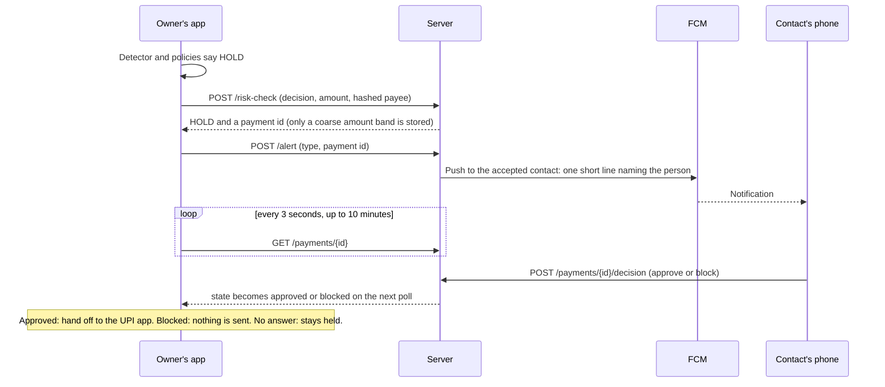
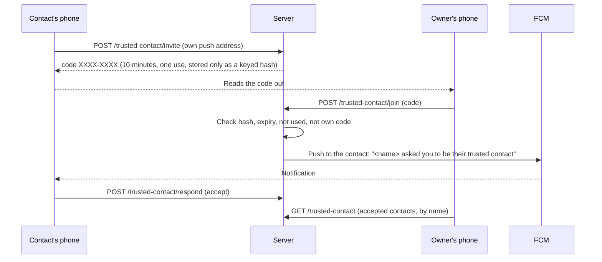
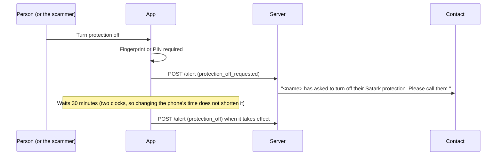

# Architecture

This document goes one level below the README: how the pieces talk to each other, what is stored where, and what each part is trusted to do.

- [Components](#components)
- [Flows](#flows)
- [Server data model](#server-data-model)
- [Data inventory](#data-inventory)
- [Trust boundaries](#trust-boundaries)
- [Design decisions](#design-decisions)

## Components

| Component | Where | Responsibility |
|---|---|---|
| Signal sources | `app/.../signals/` | Unknown calls and video, installs (Play, sideload, remote-access watch-list), strangers' texts (sender only), usage access. Raw signals become events. |
| Device check | `app/.../security/DeviceCheck.kt` | When the person goes to pay, lists installed apps and flags remote-access apps, root tools, modified copies, payment apps from outside a store and other sideloaded apps. A warning only. |
| Detector | `detector/` (Kotlin library, used by the app) | Turns events into a decision (`NONE` or `HARD`, a score, one to three reason codes). Deterministic, no clock, no randomness. |
| App policies | `app/.../events/` | Split guard, high-value new payee, nudge, text burst, alert merging. They add warnings; they never remove the detector's. |
| Payments | `app/.../payments/` | Starts a payment, asks the detector and policies, then nudges, holds, or hands off to a UPI app or a Razorpay checkout. |
| Lock and protection | `app/.../ui/lock/`, `protection/` | Fingerprint or PIN gate, the 30-minute protection-off wait, the device-admin removal guard. |
| Account and push | `app/.../account/`, `push/` | Optional phone sign-in; registers the phone's own push address; shows alerts on the contact's phone. |
| Backend | `server/app/` | Device identity, accounts, payment state, trusted-contact links and invites, alerts, webhooks, anonymous signatures. |
| Contracts | `contracts/` | The API (OpenAPI), the detector's input schema, reason codes, the UPI mapping, the auth contract. |

## Flows

### Device registration

The phone proves it holds a hardware-backed key before it gets a token. There is no password.

```mermaid
sequenceDiagram
    participant A as App
    participant S as Server
    A->>S: POST /auth/challenge
    S-->>A: nonce (single use, short life)
    A->>A: Create a key in secure hardware, attest it with the nonce
    A->>S: POST /auth/device (nonce, public key, attestation chain)
    S->>S: Verify chain to pinned Google roots, app package and signing certificate, nonce, revocation
    S-->>A: access token (short) and refresh token (single use)
    A->>S: POST /auth/refresh when the access token expires
    S-->>A: new pair; replaying an old refresh token revokes the device
```

On a debug build against a development-mode server, the app falls back to `/auth/dev-token` when attestation is refused. A release build never does, and the server refuses to boot
with that route enabled outside development.

### A held payment, with the contact's decision



"Continue anyway" on the Stop screen is the other way out. It needs a fingerprint (or the screen-lock PIN), then asks the server to release the person's own hold.

### Linking a trusted contact



A wrong, used or expired code all get the same answer. Nothing reaches the contact until they accept. An owner never supplies a push address, so a person controlling the owner's
phone cannot redirect the contact's alerts.

### Turning protection off



## Server data model

| Table | Holds | Notes |
|---|---|---|
| `devices` | Device id, public key, attestation level, push address, optional `account_id`, revoked flag | One row per phone. |
| `accounts` | Keyed hash of a phone number, optional display name | Several phones can share one account. The number itself is never stored. |
| `refresh_tokens`, `auth_challenges` | Hashed single-use refresh tokens; one-time nonces | Reuse of a refresh token revokes the device. |
| `trusted_links` | Owner device, contact device, status (`pending`, `accepted`, `revoked`) | Only `accepted` links receive anything. |
| `trusted_invites` | Contact device, keyed hash of the invite code, expiry, used flag | Short-lived; cleared by *Delete my data*. |
| `payments` | Device, method, **amount band**, **hashed payee**, state, hold reason, who decided | The rupee amount is not stored. |
| `webhook_events` | Razorpay event ids | Deduplication. |
| `alerts` | Device, type, delivered flag, failure reason | No reasons, amounts or payees. |
| `audit_log` | Reviewed alert actions | |
| `signatures` | Anonymous pattern features | **No device id column at all.** |

Redis, when used, holds rate-limit counters only. It never holds payment or session state, and if it is down the limiter fails open (rate limiting is abuse control, not authentication).

## Data inventory

| Data | Where it lives | Leaves the phone? |
|---|---|---|
| Calls, installs and which app is in use | Processed on the phone to make events | No. Events are kept briefly in a local queue and purged. |
| Text messages | Only the sender's number is checked against contacts; the arrival time is kept for the burst count | No. The message body is never read. |
| Amount and payee of a payment | On the phone, to make a decision | The server receives an **amount band** and a **keyed hash** of the payee. |
| Usual payment size | Local table of completed payments (used for the baseline) | No. |
| Known payees | Local table of payee hashes | No. |
| Age | On the phone only | No. It only selects a stricter threshold. |
| Phone number | Typed once at sign-in and checked by Firebase | The server keeps only a **keyed hash**. The phone keeps a masked form (`+91 ••••• 3210`) for display. |
| Display name | On the phone and in `accounts` | Yes, to the contact's notification, if the person gave one. |
| Push address | The phone, and `devices.fcm_token` | Yes, to the server, so alerts can reach the phone. |
| Invite code | Shown on the contact's screen | The server keeps only a **keyed hash**, marked used or expired, until *Delete my data* removes it. |
| Detector decisions | Local log (level, score, reason codes) | Only anonymous signatures, with no identifier. |

*Delete my data* (`DELETE /device`) erases a device's payments, alerts, links, invites, tokens and account link on the server, and empties the local tables.

## Trust boundaries

| Boundary | What crosses | What protects it |
|---|---|---|
| Phone ↔ server | JWT-bearer API calls over HTTPS | Key Attestation identity, short-lived tokens, single-use refresh, rate limits, strict input models, owner-scoped lookups. |
| Server ↔ Razorpay | Orders out; webhooks in | HMAC-SHA256 of the **raw** body is verified with a constant-time compare before any parsing. A missing secret fails closed. |
| Server ↔ Firebase | Push out; sign-in tokens verified | A service-account credential held only as a server environment variable. An unverifiable token is a generic 401. |
| Person ↔ scammer on the phone | Taps and remote-screen control | Lock on every action a scammer would ask for; 30-minute wait with an immediate alert to the contact; uninstall guard. |
| Contact ↔ owner | A short code, then an accept tap | One use, ten minutes, hashed at rest, rate limited; the contact's own phone supplies its push address. |

Not yet built: certificate pinning, a restricted database role, pinned Google attestation roots (the server refuses to start in production without them), and a release signing key.

## Design decisions

- **Detection on the phone.** Privacy, latency, and it still works when the server is asleep or unreachable.
- **A simple, explainable detector.** A logistic score with conformal thresholds can be audited, can state its false-alarm target per age band, and can explain itself in a sentence.
- **Policies add, never remove.** The detector is frozen against 36 test vectors. Improvements arrive as separate policies that can only make Satark warn more, so they cannot silently
  break what was tested.
- **Hold, don't just warn.** A tap-away warning does not help a frightened person. Holding the payment and bringing a contact in changes the situation.
- **An unanswered hold stays held.** Releasing on a timeout would give a scammer a countdown.
- **Amount bands and hashes on the server.** The server does not need the rupee amount or the payee's identity to hold a payment or fan-in check a payee.
- **Sign-in is optional.** The protection must not depend on an account; the account only adds a name for the contact.
